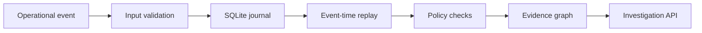

# Event journal and evidence model

## Boundary

The static graph explorer uses a curated synthetic scenario. The operational journal is a separate, persistent subsystem available only when running the local Python server. This avoids suggesting that GitHub Pages hosts the API.

## Data flow



## Contract

Each event supplies `event_id`, `task_id`, `event_type`, `occurred_at` (timezone-aware ISO 8601), `source`, and optional object `payload`. An identical replay returns `inserted: false`; reusing an ID with different content is rejected. Each task's current state is rebuilt in timestamp order, with the event ID as tie-breaker.

## Caveats

- This is a single-node reference architecture, not a distributed event stream. SQLite has no cross-service transaction or production-grade ingestion pipeline here.
- Event-time ordering treats late arrivals as historical facts; findings may change after new events are ingested. Consumers should not treat a previously generated report as immutable.
- `CUSTODY_BEFORE_CLOSURE` and `PAYMENT_WITHOUT_CUSTODY` are explicit illustrative rules, not learned classifiers, proofs of causation, or policies from a real employer.
- The API is designed for localhost demonstration: there is no authentication, authorization, rate limiting, or tenant isolation. Do **not** expose it to the public internet.
- Changes to a previously accepted event require a new corrective event in a production design; conflicting event ID replays are deliberately rejected here.

## Example

Start with `python -m app.server` and run:

```bash
curl -X POST http://127.0.0.1:8000/api/events \
  -H 'Content-Type: application/json' \
  -d '{"event_id":"evt-100","task_id":"pickup-314","event_type":"task_created","occurred_at":"2026-10-01T10:00:00Z","source":"dispatch","payload":{}}'

curl 'http://127.0.0.1:8000/api/investigate?task_id=pickup-314'
```

Supported event types: `task_created`, `driver_confirmed`, `payment_settled`, `custody_verified`, `task_closed`.
